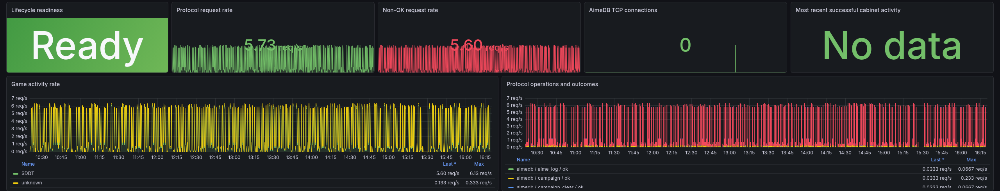
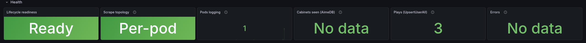
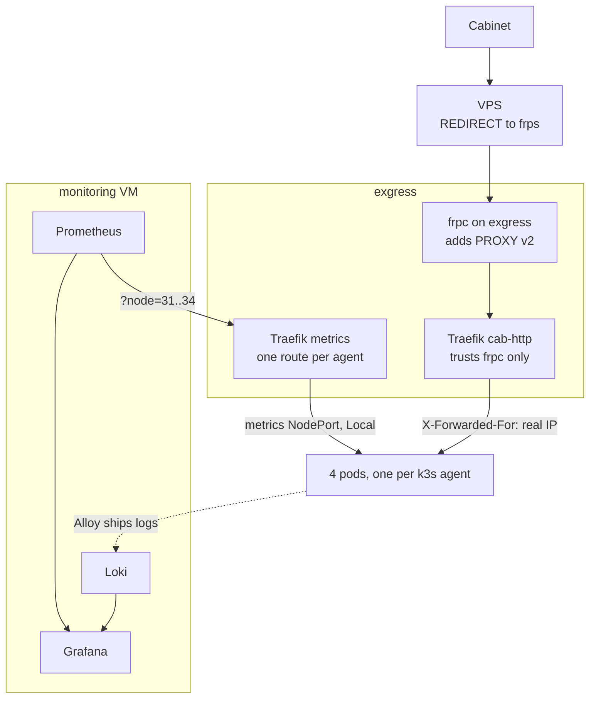

+++
banner = 'https://raw.githubusercontent.com/Umi4Life/umi4.life/refs/heads/master/content/posts/prometheus-fabricated-rates/images/grafana-after.png'
cover = 'https://raw.githubusercontent.com/Umi4Life/umi4.life/refs/heads/master/content/posts/prometheus-fabricated-rates/images/grafana-after.png'
date = '2026-10-17T09:40:00+07:00'
draft = false
translationKey = 'prometheus-fabricated-rates'
title = "My dashboard invented 7,694 requests an hour"
subtitle = "Scraping four replicas through one load-balanced target, and every cabinet showing up as 10.42.0.0"
description = "Why Prometheus reported traffic that never happened when it scraped a load-balanced k3s Deployment, how per-pod NodePorts with externalTrafficPolicy Local fixed it, and how frp PROXY protocol brought back real cabinet IPs."
tags = ["prometheus", "grafana", "loki", "traefik", "frp", "proxy-protocol", "k3s", "kubernetes", "observability", "homelab"]
categories = ["homelab", "kubernetes", "private-server"]
mermaid = true
+++






## Background

My two arcade servers, Sumeragi and Rche, run as four replicas each on a k3s cluster in my homelab DMZ (the [k3s series](https://umi4.life/posts/sumeragi-k3s-zero-downtime/) covers how they got there). Rche already had a full Grafana dashboard with every game and cabinet. Sumeragi had logs and nothing else.

> sumeragi is lacking grafana metrics unlike rche right now

So Sumeragi got [Grafana Alloy](https://grafana.com/docs/alloy/latest/) shipping pod logs to Loki, plus a bearer-protected `/metrics` endpoint with `sumeragi_` metrics. Prometheus and Grafana run on a monitoring VM on my LAN, which can't reach the DMZ, so Prometheus scrapes through a Traefik entrypoint on exgress, my edge VM, which only answers to the monitoring host.

The dashboard went up, and it looked busy.

---

## Traffic that never happened



5.73 requests a second, 5.60 of them "non-OK", and nobody was playing. Loki had zero title-server log lines for the same hour. One of the two was making things up, and the logs had no reason to.

(The "non-OK" part was its own small bug. Title requests report HTTP status classes, and `result!="ok"` counted every `2xx` as a failure.)

The real clue was a metric that should almost never change:

```text
changes(process_start_time_seconds{job="sumeragi"}[1h])   91
changes(process_start_time_seconds{job="rche"}[1h])       94
real restarts in that hour                                 1
```

A process start time only changes when the process restarts. Prometheus saw it change 91 times in an hour, cycling between a handful of values, one per pod.

### Why

Prometheus had one target per app: the exgress entrypoint. Behind it, Traefik load-balanced across the four agents, and the NodePort behind that used the default `externalTrafficPolicy: Cluster`, which forwards to any pod in the cluster. Two layers of load balancing, so every scrape landed on whichever pod it got.

```text
Prometheus -> exgress:19084 -> Traefik round-robin
                                 -> 10.10.10.31-34:30080  NodePort (Cluster)
                                      -> any of 4 pods
```

Each pod keeps its own counters. Over that hour, the Sumeragi title counter only ever took four values:

```text
scrape 1  pod B   requests_total 195
scrape 2  pod A   requests_total 168    looks like a reset
scrape 3  pod D   requests_total 184    +16
scrape 4  pod C   requests_total 180    another reset
```

Prometheus treats a counter going down as a process restart and counts the new value from zero. 40 drops in 120 samples, each one turned into fresh traffic by `rate()` and `increase()`, added up to 7,694 requests that never happened. Rche had the exact same setup and the same inflated numbers. Its rates just looked plausible enough that nothing flagged them.

The setup made sense once. `/metrics` was added when each app was a single container, and the single target stayed in place after both scaled out to four replicas.

---

## One target per pod

A Prometheus target has to be one process. The pods are in the DMZ and Prometheus isn't, so the path still goes through exgress, and the fix has three pieces.

### A metrics NodePort that stays on its node

A separate NodePort for metrics, with `externalTrafficPolicy: Local`. A node only answers with its own pod, and refuses the connection if it has none. Sumeragi has required anti-affinity, one pod per agent, so one agent address means one pod:

```yaml
apiVersion: v1
kind: Service
metadata:
  name: sumeragi-metrics
  namespace: sumeragi
spec:
  type: NodePort
  externalTrafficPolicy: Local
  selector:
    app.kubernetes.io/name: sumeragi
  ports:
    - name: metrics
      port: 8080
      targetPort: http
      nodePort: 30087
```

Rche got the same on `30088`. In a throwaway k3s cluster with two agents, each agent's port returned its own pod 6 out of 6 times, and the server node refused.

### One Traefik route per agent

My first draft was eight hand-written routers, two apps times four agents.

> for traefik and prometheus is there more elegant way to do it. especually for traefik that I apparantly have to create whole sumeragi-metrics-31 to 34 routers

Traefik's file provider renders Go templates, so it became one file. The agent is picked by a `node` query parameter:

```yaml
{{- $nodes := list "31" "32" "33" "34" }}
{{- $apps := dict "sumeragi" "30087" "rche" "30088" }}
http:
  routers:
{{- range $app, $port := $apps }}{{- range $node := $nodes }}
    {{ $app }}-metrics-{{ $node }}:
      rule: "Path(`/metrics`) && Query(`node`, `{{ $node }}`)"
      entryPoints: [{{ $app }}-metrics]
      middlewares: [{{ $app }}-metrics-allowlist, {{ $app }}-metrics-headers]
      service: {{ $app }}-metrics-{{ $node }}
{{- end }}{{- end }}
  services:
{{- range $app, $port := $apps }}{{- range $node := $nodes }}
    {{ $app }}-metrics-{{ $node }}:
      loadBalancer:
        servers:
          - url: "http://10.10.10.{{ $node }}:{{ $port }}"
{{- end }}{{- end }}
```

Adding an agent means adding its last octet to `$nodes`.

### Prometheus relabeling

The targets are the real agent addresses, but Prometheus never connects to them. Relabeling turns the last octet into the `node` parameter, keeps the agent address as `instance`, and swaps the address for exgress:

```yaml
- job_name: sumeragi
  metrics_path: /metrics
  static_configs:
    - targets: ['10.10.10.31:30087', '10.10.10.32:30087', '10.10.10.33:30087', '10.10.10.34:30087']
  relabel_configs:
    - {source_labels: [__address__], regex: '.*\.(\d+):\d+', target_label: __param_node}
    - {source_labels: [__address__], target_label: instance}
    - {target_label: __address__, replacement: '<exgress>:19084'}
```

### Traefik didn't notice

In production, the new routers didn't show up. Traefik was still serving the old config, and its log explained half of it: creating the new file had triggered a reload while another file had a duplicate `middlewares:` key, so Traefik rejected the whole reload. That file was fixed seconds later, but nothing reloaded again.

I reproduced the other half on the same Traefik version (3.6.11): edits to files inside subdirectories of the dynamic config folder don't trigger a reload. Only top-level files do.

```bash
touch traefik/dynamic/metrics-per-node.yaml
```

### Dashboards that double counted

Now every pod is its own series, and a few panels started counting things four times. Rche's database totals, like web users, are reported by every pod, so `sum` turned 4 users into 16. Those became `max`. Per-client "last seen" gauges are combined across pods before counting, which took Rche's "clients up" from 4 back to the real 3. Rates were already fine with `sum(rate(...))`.

### After

```text
targets up                                    8/8
changes(process_start_time_seconds[5m])       0 on every instance
```



The request rate went from a fabricated 5.7 a second to about 0.001, which is what one idle cabinet looks like when it sends a keepalive every 14 minutes. Sumeragi's dashboard also got a "Scrape topology" panel, `max(changes(process_start_time_seconds[10m]))`, which goes red if a target starts hopping between processes again.

> [!TIP]
> A Prometheus target must be exactly one process. If you scrape replicas through anything that load-balances, check `changes(process_start_time_seconds[10m])`. Outside a deploy it should be 0.

---

## Every cabinet was 10.42.0.0

Sumeragi's cabinet panels were empty for a different reason. They only labeled cabinets registered in the database, and my cabinet isn't. It reports the segatools default keychip, and Sumeragi doesn't enforce keychips. So I added client metrics like Rche's, keyed on the reported keychip with the client IP as a fallback, capped at 256 clients per pod.

The first client to show up had the IP `10.42.0.0`, a Kubernetes pod network address. Every cabinet did.

> as for 10.42.0.0 it's frpc to my vps

My ISP puts me behind CGNAT, so cabinets reach a VPS, and frp tunnels the traffic home to exgress. Tracing it hop by hop:

```text
cabinet -> VPS :80
  iptables REDIRECT to frps :18080        real IP kept
frps -> frpc on exgress                   real IP dropped, frpc sends plain TCP
frpc -> server-1 NodePort 30080           NodePort SNATs to 10.42.0.0
```

The VPS was fine, since REDIRECT only rewrites the destination. The address got lost when frpc opened a fresh connection on exgress, and the NodePort made it worse. That path also sent every cabinet to one VM, server-1.

frp can prepend a [PROXY protocol](https://www.haproxy.org/download/2.9/doc/proxy-protocol.txt) v2 header with the original address, but something has to read it, and a NodePort can't. Traefik can. So cabinet HTTP goes to a new Traefik entrypoint that trusts PROXY headers from frpc only, and Traefik passes the address on in `X-Forwarded-For`.

I tried it in a local lab first, with frps, frpc and Traefik in Docker and a fake cabinet. The real address came through. A client-sent `X-Forwarded-For: 6.6.6.6` got overwritten, and a PROXY header from an untrusted source claiming `9.9.9.9` was ignored.

Production was a few lines. frpc:

```ini
[sumeragi-allnet]
local_ip = 127.0.0.1
local_port = 18080
remote_port = 18080
proxy_protocol_version = v2
```

Traefik, published on loopback only, trusting just the Docker bridge gateway that frpc's traffic arrives from:

```yaml
entryPoints:
  cab-http:
    address: ':18080'
    proxyProtocol:
      trustedIPs: ["172.21.0.1/32"]
```

Order mattered: Traefik first, then frpc, because a PROXY header sent to an entrypoint that doesn't expect it is garbage at the start of an HTTP request. After the switch:

```text
cab-http requests    99, all 200
per agent            25 / 25 / 25 / 24
client address       real cabinet IP
```

The cabinet's real IP showed up in the logs and in the client metrics, and its requests spread across all four agents instead of all landing on server-1. AimeDB and billing are raw TCP and still go through server-1, so those still say `10.42.0.0` until Sumeragi learns to read PROXY headers itself.

---

## How it fits together now



## Related posts





