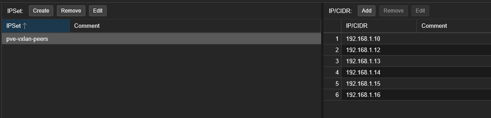
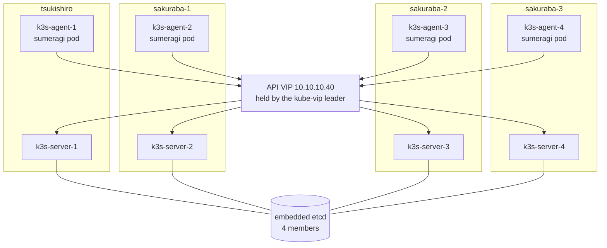

+++
banner = 'https://raw.githubusercontent.com/Umi4Life/umi4.life/refs/heads/master/content/posts/sumeragi-k3s-control-plane-ha/images/pve-vxlan-peers.png'
cover = 'https://raw.githubusercontent.com/Umi4Life/umi4.life/refs/heads/master/content/posts/sumeragi-k3s-control-plane-ha/images/pve-vxlan-peers.png'
date = '2026-10-17T09:30:00+07:00'
draft = false
translationKey = 'sumeragi-k3s-control-plane-ha'
title = "Migrating my arcade server to k3s, Part 2"
subtitle = "More Proxmox machines, more control planes, and pulling the plug on server-1"
description = "Part 2 of running Sumeragi on k3s: new bare-metal Proxmox hosts, a VXLAN outage caused by one firewall IPSet, three k3s servers with embedded etcd and kube-vip, and the kill test."
tags = ["k3s", "kubernetes", "etcd", "kube-vip", "high-availability", "proxmox", "vxlan", "terraform", "ansible", "homelab"]
categories = ["homelab", "kubernetes", "private-server"]
mermaid = true
+++






## Background

[Part 1](https://umi4.life/posts/sumeragi-k3s-zero-downtime/) ended on two Proxmox hosts and a single k3s server, and the top of my wishlist was a third worker and control-plane HA. Both were really waiting on hardware. Then I got more bare-metal machines, and the Proxmox cluster went from two hosts to six.

More hosts meant more places to put k3s VMs, so this part is the follow-up: more agents, more servers, and a test to see whether losing a server still matters.

---

## New hosts, and the network went quiet

Agents 3 and 4 went onto two of the new hosts. Terraform cloned and booted them fine, and then Ansible couldn't reach either one:

```text
k3s-agent-4: connect failed: No route to host
k3s-agent-3: Connection timed out during banner exchange
```

My DMZ is a Proxmox SDN zone stretched across the hosts with VXLAN, so each host wraps DMZ traffic in UDP on port 4789 and sends it to the others. Going down the stack:

```text
VM running with the right IP                     ok
tap attached to the dmznet bridge                ok
ARP for the DMZ gateway                          INCOMPLETE
VNI and port identical on every host             ok
tcpdump: VXLAN frames leaving the new host       yes
replies coming back                              none
```

Frames left and nothing came back, so the drop was on the receiving side. Proxmox's cluster firewall has an IPSet, `pve-vxlan-peers`, listing which hosts may send VXLAN traffic. The new hosts were in the SDN peer list but not in the firewall's, so everything they sent was dropped on arrival.

I found it and added them by hand:



> turns out it was missing ipset. I've added the ips and it fixed everything / make this durable and unmissable by implementing to tsukishiro-iac

So now one inventory in Terraform drives the SDN zone's nodes, its peers and the firewall IPSet:

```hcl
locals {
  proxmox_nodes = {
    tsukishiro = { underlay_ip = "...", vxlan = true }
    sakuraba-1 = { underlay_ip = "...", vxlan = true }
    # one line per host
  }
  vxlan_node_names = sort([for name, node in local.proxmox_nodes : name if node.vxlan])
  vxlan_peers      = [for name in local.vxlan_node_names : local.proxmox_nodes[name].underlay_ip]
}

resource "proxmox_sdn_zone_vxlan" "dmz" {
  id    = "dmzvx"
  mtu   = 1450
  nodes = local.vxlan_node_names
  peers = local.vxlan_peers
}

resource "proxmox_virtual_environment_firewall_ipset" "vxlan_peers" {
  name = "pve-vxlan-peers"
  dynamic "cidr" {
    for_each = local.vxlan_peers
    content { name = cidr.value }
  }
}
```

Adding a host is one line, and the firewall can't fall behind anymore.

> [!TIP]
> When two lists have to agree, generate both from one. My SDN peers and firewall IPSet were kept separately, and they drifted the first time I added hosts.

---

## Choosing how the control plane survives

Before adding servers I had one worry:

> I have concern where we will run into problem with server config not being replicated. check via ssh to exgress -> ssh to k3s server and check the /protected dir / or are we better off just set up HA on single k3s server

`/protected` turned out to be my staging folder on server-1 from the Compose days. Nothing in the cluster mounted it, and everything the pods use already lives in etcd, which replicates. So it got a weekly backup to my NAS and stopped being a blocker.

That left two real options:

```text
A  Proxmox HA for the one server VM
   restarts on another host, a few minutes with no API,
   and it can lose the latest etcd writes

B  three k3s servers with embedded etcd, plus kube-vip
   any one server can die, the API stays up on a floating IP
```

I went with B. Server-1 had run embedded etcd since day one (`cluster-init: true` in Part 1), so there was no datastore migration. In Ansible, the first server initialises the cluster and the others join it one at a time:

```yaml
# ansible/roles/k3s_server/templates/config.yaml.j2

cluster-init: true

server: https://{{ hostvars[k3s_first_server].ansible_host }}:6443
token: {{ hostvars[k3s_first_server].k3s_server_token | to_json }}

tls-san:
  - {{ k3s_api_vip }}
```

Each server runs [kube-vip](https://kube-vip.io/) as a static pod. The servers elect a leader, the leader answers for the API VIP `10.10.10.40`, and the agents point at the VIP instead of server-1.

---

## Pulling the plug on server-1

I stopped `k3s` on server-1 while it was the VIP leader, the worst one to lose, and watched for two minutes:

```text
systemctl stop k3s                 (k3s-server-1, current VIP leader)

VIP ping                           answered every poll
https://10.10.10.40:6443/readyz    ok for the whole window
agents 1-4                         Ready throughout
k3s-server-1                       NotReady after ~45 s
VIP lease plndr-cp-lock            moved to k3s-server-2

systemctl start k3s
k3s-server-1                       Ready in ~15 s, etcd healthy
```

The API never went away, no agent noticed, and server-1 rejoined by itself.

## One of each per host

Later I added a fourth server so every k3s host gets one server and one agent, in name order. Four etcd members still tolerate only one failure, same as three, but I wanted the tidy layout.

Moving VMs between hosts through Terraform turned out to be destructive. Changing `node_name` on a VM with local disks means destroy and recreate:

```text
Plan: 4 to add, 10 to change, 4 to destroy
```

So I live-migrated them by hand instead, one at a time, waiting for every server to be `Ready` before the next:

```bash
qm migrate 9110 tsukishiro --online --with-local-disks 1 --targetstorage local-lvm
```

With the VMs already where the code said they should be, the same plan had nothing left to destroy:

```text
Plan: 0 to add, 14 to change, 0 to destroy
```

The cluster now:

```text
tsukishiro   k3s-server-1  .30    k3s-agent-1  .31
sakuraba-1   k3s-server-2  .35    k3s-agent-2  .32
sakuraba-2   k3s-server-3  .36    k3s-agent-3  .33
sakuraba-3   k3s-server-4  .37    k3s-agent-4  .34

API VIP 10.10.10.40 (kube-vip)
```

Sumeragi went to four replicas, one per agent, and rollouts now replace two at a time with the PodDisruptionBudget still in place.

## How it fits together now



Every host sits on the same VXLAN DMZ, with its peers and firewall IPSet generated from one Terraform inventory.

The next post is about getting images from CI into acid without me pasting digests by hand.

## Related posts




