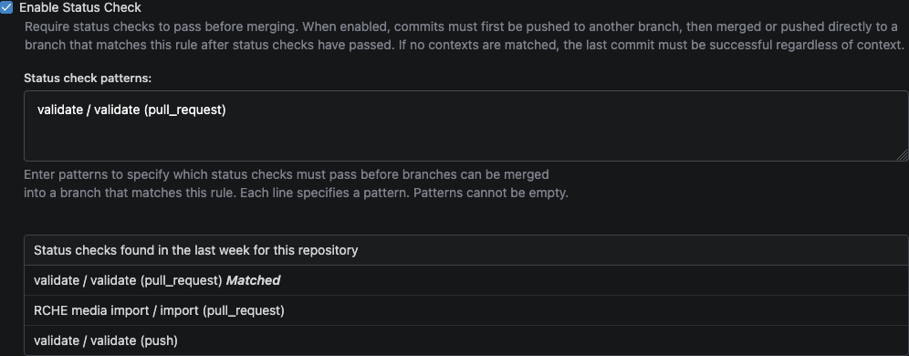
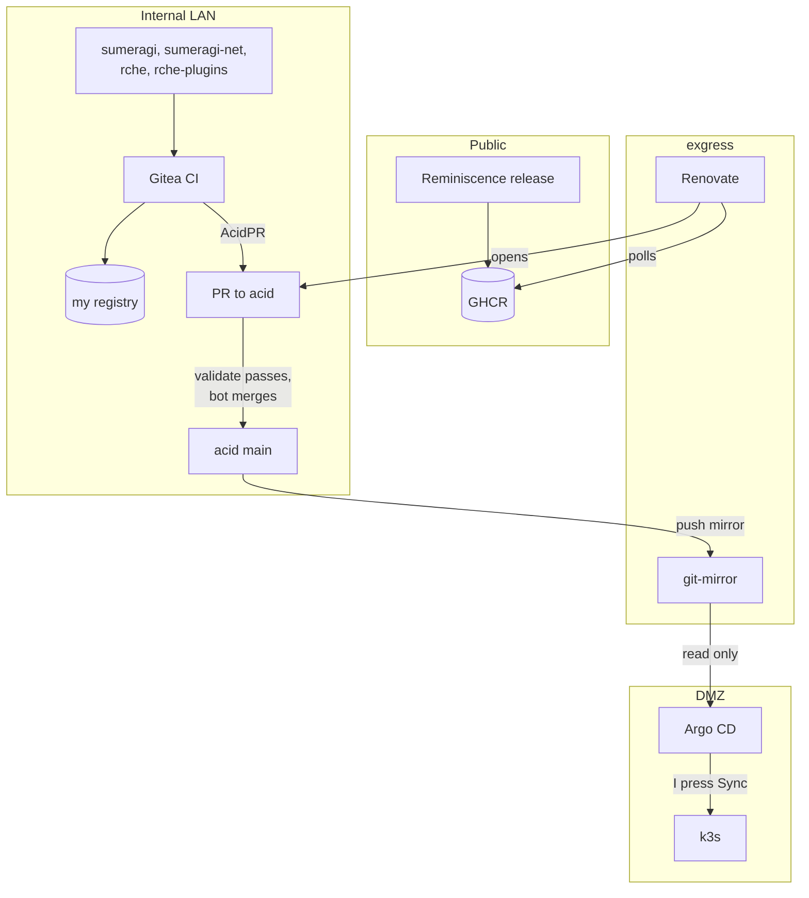

+++
banner = 'https://raw.githubusercontent.com/Umi4Life/umi4.life/refs/heads/master/content/posts/sumeragi-k3s-image-promotion/images/acid-required-check.png'
cover = 'https://raw.githubusercontent.com/Umi4Life/umi4.life/refs/heads/master/content/posts/sumeragi-k3s-image-promotion/images/acid-required-check.png'
date = '2026-10-17T09:31:00+07:00'
draft = false
translationKey = 'sumeragi-k3s-image-promotion'
title = "Migrating my arcade server to k3s, Part 3"
subtitle = "Getting new images into GitOps without hand-editing digests"
description = "Part 3 of running Sumeragi on k3s: Renovate for a public GitHub release, AcidPR for in-house CI images, and one policy file that decides what may be promoted where."
tags = ["gitops", "argo-cd", "renovate", "gitea", "ci-cd", "kustomize", "k3s", "homelab"]
categories = ["homelab", "kubernetes", "private-server"]
mermaid = true
+++






## Background

By the end of [Part 1](https://umi4.life/posts/sumeragi-k3s-zero-downtime/), a deploy was a reviewed commit to `acid`, my GitOps repo, followed by a click on Sync in Argo. The commit was the annoying part. CI built an image, I copied its digest out of the log, opened acid, pasted it into a `kustomization.yaml` and opened a PR. Fine for one app, old fast with five:

```text
sumeragi       arcade backend                        built in my Gitea CI
sumeragi-net   web companion, API + web images       built in my Gitea CI
rche           e-amusement server core               built in my Gitea CI
rche-plugins   rche's plugin artifact                built in my Gitea CI
reminiscence   arcade queue board, public on GitHub  released to GHCR
```

What I wanted:

> make each application repo (sumeragi, sumeragi-net, rche, reminiscence) auto pushes new image to acid on main branch ci success

The one rule I didn't want to bend: Argo stays manual. Automation can propose and merge the commit, and I still press Sync.

---

## The public repo that can't know my Git exists

Reminiscence is the odd one. It's public on GitHub and releases to GHCR. The obvious design is a GitHub Action that clones acid and pushes a bump, and I didn't want that:

> I don't want to have acid name or my internal infra known to public / also git.umi4.life is not public. github wont be able to reach it

That ruled out a few designs in a row. A signed public relay was still too much surface. A webhook receiver on the edge, first custom and then [adnanh/webhook](https://github.com/adnanh/webhook) behind a Cloudflare tunnel, still felt bespoke:

> it still feels too bespoke, I'd prefer a complete service I can just put on services's image: in compose

After a proper look at what people run for this, the answer was the boring one: self-hosted [Renovate](https://docs.renovatebot.com/). It polls GHCR from inside my network and opens PRs against acid, and GitHub never learns anything.

### Renovate in k3s couldn't reach Git either

The first Renovate ran as a CronJob in the cluster and failed with `Authentication failure`. The token was fine:

> it's the same dmz problem again. k3s server is not in the same lan as gitea

From the k3s nodes, `git.umi4.life` doesn't even resolve, and the read-only mirror Argo uses can't serve Renovate, which needs the Gitea API. Renovate moved to Docker Compose on exgress, the edge VM that can see both sides, and runs every five minutes.

The config turns everything off and then allows one image:

```json
{
  "enabledManagers": ["kustomize"],
  "automerge": false,
  "packageRules": [
    {
      "description": "Disable every Kustomize Docker dependency until explicitly allowlisted",
      "matchManagers": ["kustomize"],
      "matchDatasources": ["docker"],
      "enabled": false
    },
    {
      "matchFileNames": ["applications/reminiscence/kustomization.yaml"],
      "matchPackageNames": ["ghcr.io/umi4life/reminiscence"],
      "enabled": true,
      "versioning": "regex:^v(?<major>0|[1-9][0-9]*)\\.(?<minor>0|[1-9][0-9]*)\\.(?<patch>0|[1-9][0-9]*)$",
      "pinDigests": true,
      "automerge": true,
      "automergeType": "pr",
      "ignoreTests": false
    }
  ]
}
```

The first run did the wrong thing: it pinned the old unprefixed `1.1.1` tag to a digest, and acid's validation rejected the PR. Once Reminiscence published only `vX.Y.Z` tags, Renovate opened `v1.1.2 → v1.1.3@sha256:8d4b7c80…`, CI checked the tag against the GitHub release and the GHCR digest, and `renovate-bot` merged it.

> auto merge went through and showed diff on argo

---

## In-house images: AcidPR

The other four apps are built in my own CI, so there's no public release to poll. Instead, CI opens the bump PR itself, through a small tool I call AcidPR.

It's a step in each app's build job, between pushing the image and cleanup:

```yaml
- name: Bump AcidPR
  if: gitea.event_name == 'push' && gitea.ref == 'refs/heads/sumeragi'
  env:
    ACIDPR_GITEA_TOKEN: ${{ secrets.ACIDPR_BOT_GITEA_TOKEN }}
    IMAGE_DIGEST: ${{ steps.push.outputs.image_digest }}
  run: |
    git clone --depth=1 https://git.umi4.life/umi4life/acid.git acid
    acid/scripts/acidpr-promote-image.sh \
      --repo acid \
      --publish \
      --application sumeragi \
      --source-repository umi4life/sumeragi \
      --source-revision '${{ gitea.sha }}' \
      --image "registry.umi4.life/sumeragi@${IMAGE_DIGEST}"
```

AcidPR opens a PR as `acidpr-bot`, and Gitea merges it once acid's required `validate` check passes. The bot can write to acid and nothing else, and its token is one user-level secret shared by every app repo.



### One policy file

AcidPR itself knows nothing about my apps. Everything app-specific lives in one reviewed file in acid: which repo may build which image, which files that image may be written to, and how it's referenced.

```yaml
# acid/config/image-promotion-policy.yaml
applications:
  sumeragi:
    sourceRepository: umi4life/sumeragi
    targets: [applications/sumeragi/kustomization.yaml]
    images: [registry.umi4.life/sumeragi]
    referencePolicy: digest
  rche-plugins:
    sourceRepository: umi4life/rche-plugins
    targets: [applications/rche/kustomization.yaml]
    images: [registry.umi4.life/rche-plugins-artifact]
    referencePolicy: digest
  reminiscence:
    sourceRepository: Umi4Life/reminiscence
    targets: [applications/reminiscence/kustomization.yaml]
    images: [ghcr.io/umi4life/reminiscence]
    referencePolicy: numbered-version
    renovate: true
```

A request that doesn't match its entry, like the wrong source repo or an image the app doesn't own, gets rejected before anything is written. So does an unknown `referencePolicy`. Apps with `renovate: true` belong to Renovate, and acid's tests build the Renovate allowlist from the same file. Adding an app means adding an entry, and the script and tests stay the same.

### Getting all four through

Each app's first real run broke on something small. One runner had no PyYAML. Another refused `pip install` under PEP 668 until it got a venv. One image reference came out with the registry prefix twice. The plugin publisher pushed under the registry's internal hostname, which didn't match the name in the policy.

After those fixes, a push to each app's main branch built the image, opened a PR in acid, passed `validate`, and got merged by `acidpr-bot`. Then I synced all four in Argo by hand. Rche's core and plugin images are promoted separately, so what runs is always a pair I picked.

> [!TIP]
> When only one side can see the other, make the side that can see pull. My internal Renovate polls public GHCR, so the public repo never needs to know my Git exists.

## How it fits together now



Merging takes care of itself now. Syncing is still my click.

## Related posts




