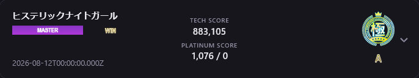
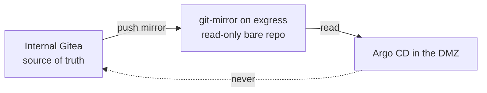
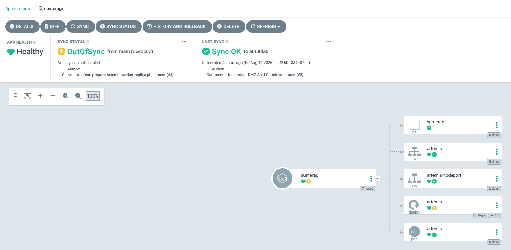
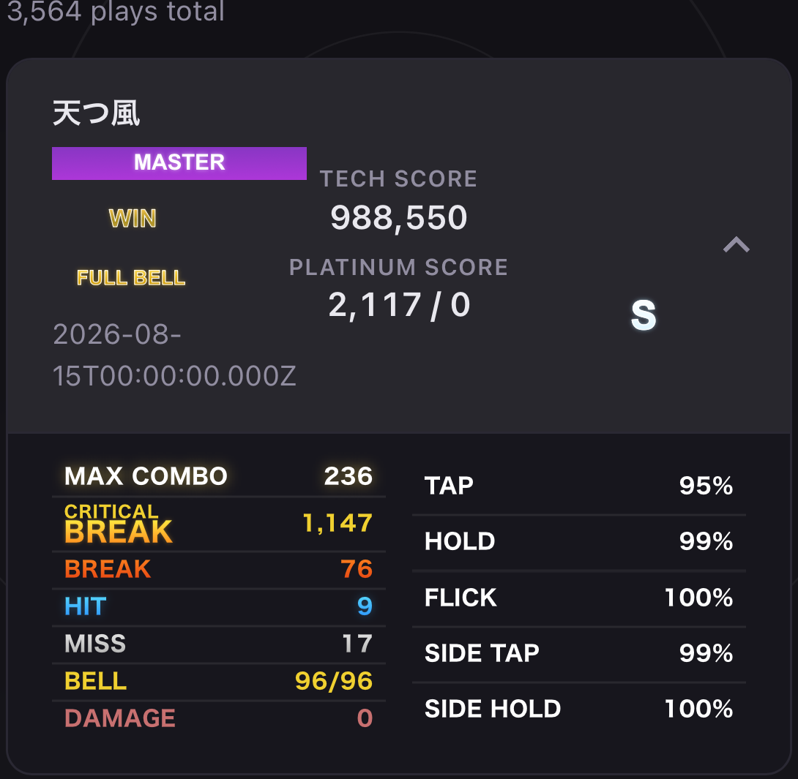

+++
banner = 'https://raw.githubusercontent.com/Umi4Life/umi4.life/refs/heads/master/content/posts/sumeragi-k3s-zero-downtime/images/argo-first-sync.png'
cover = 'https://raw.githubusercontent.com/Umi4Life/umi4.life/refs/heads/master/content/posts/sumeragi-k3s-zero-downtime/images/argo-first-sync.png'
date = '2026-10-17T04:30:00+07:00'
draft = false
translationKey = 'sumeragi-k3s-zero-downtime'
title = "Migrating my arcade server to k3s, Part 1"
subtitle = "From one Docker Compose box to k3s and Argo CD, tested by playing a credit through the rollout"
description = "Part 1 of moving Sumeragi, a raw-TCP SEGA ALL.Net/AimeDB arcade backend, from Docker Compose to k3s and Argo CD on a self-hosted Proxmox homelab: graceful drain, the cluster, the cutover, and the GitOps repo that runs it."
tags = ["k3s", "kubernetes", "argo-cd", "gitops", "proxmox", "tcp", "arcade", "docker", "homelab", "zero-downtime", "frp", "cgnat"]
categories = ["homelab", "kubernetes", "private-server"]
mermaid = true
+++






## Background

I run a private arcade server for [ALL.Net](https://en.namu.wiki/w/ALL.Net) games called [Sumeragi](https://sumeragi.umi4.life/). It's a fork of [ARTEMiS](https://gitea.tendokyu.moe/Hay1tsme/artemis/src/branch/develop). For months it ran as a single Docker Compose service on my homelab, and every update meant restarting the one process every cabinet talks to. If someone finished a song while it was restarting, the score had nowhere to save. I wanted rollouts without that gap.

I'd already moved [Rche](https://umi4.life/posts/self-host-eamusement-server/) to Docker Swarm, and Swarm would have been enough here too. I picked Kubernetes anyway, because I wanted to practice Kubernetes and distributed systems on something with real traffic. I went with k3s since it's light and barebone, which is good for learning, and [Argo CD](https://argo-cd.readthedocs.io/en/stable/) for Git-declared state.

All of it runs on my own hardware: two Proxmox hosts at home, my own Gitea and container registry, no cloud and no managed Kubernetes. My ISP is behind CGNAT, so cabinets reach the server through a VPS and an FRP tunnel into an edge VM I call exgress (the [WireGuard post](https://umi4.life/posts/wireguard-network-setup/) covers that VPS).

<!--


*[TODO: insert server machine photo]*
-->

### What "zero downtime" can mean here

Most zero-downtime Kubernetes advice assumes HTTP. Sumeragi also speaks AimeDB, raw encrypted TCP on port 22345, plus a billing endpoint that has to be TLS passthrough. Kubernetes balances those per TCP connection, and it can't move an open socket from one pod to another. Before writing any YAML I wrote down what was possible:

- No failed *new* connections during a controlled rollout: achievable.
- Open TCP connections surviving a rollout: only if the old pod drains them before it exits.
- Open TCP connections surviving a crash or a dead node: impossible. The cabinet reconnects.

So the goal was smaller than "HA". My goal was, at minimum, is to allow players's record save request to survive during rollout deployment.

---

## Preparing Sumeragi for k3s

Sumeragi needed code changes before Kubernetes was worth trying. Kubernetes stops a pod by sending `SIGTERM`, and this process had no idea how to stop politely.

### How it worked before

One `python3 index.py` process starts several Uvicorn servers, plus AimeDB through `asyncio.start_server`. Three things made it a bad fit for rolling updates:

1. AimeDB's server handle was thrown away. `asyncio.start_server()` returns an object with `close()`, but the code never kept it, so there was no way to stop accepting new AimeDB connections while old ones finished.
2. AimeDB wasn't supervised. `index.py` watched the Uvicorn tasks, and when one ended it cancelled the rest and exited. AimeDB ran outside all of that.
3. Health was one string. `/` returned `Service OK`, which says nothing about whether every listener is up.

```python
# index.py (upstream)
task_list = [asyncio.create_task(launch_main(cfg, ssl))]
if cfg.billing.standalone:
    task_list.append(asyncio.create_task(launch_billing(cfg)))
if cfg.aimedb.enable:
    AimedbServlette(cfg).start()      # handle discarded, not supervised

done, pending = await asyncio.wait(task_list, return_when=FIRST_COMPLETED)
for t in pending:
    t.cancel("Another service died, server is shutting down")
```

On a single Compose box none of this matters. In a rolling update, a pod has to report not-ready *before* it drains while another pod keeps serving, and that's the whole game.

### The change: a lifecycle

The main change is a small state machine, `LifecycleManager`:

```text
STARTING -> READY -> DRAINING
```

```python
class ServiceState(Enum):
    STARTING = "starting"
    READY = "ready"
    DRAINING = "draining"

def begin_drain(self):
    if self._state != ServiceState.DRAINING:
        previous_state = self._state
        self._state = ServiceState.DRAINING
        self._ensure_event()
        self._shutdown_event.set()
        self._logger.info(f"Service draining (was {previous_state.value})")
```

Around it, `/ready` returns 200 only after every required listener is running, and 503 while starting or draining. `/health` stays a cheap liveness check. `SIGTERM` now means drain instead of die: the process stops every listener, gives open AimeDB connections up to 27 seconds to finish, then waits for the Uvicorn tasks, all inside one 30-second deadline. Kubernetes gets `terminationGracePeriodSeconds: 35`, so it only steps in if my code fails to exit. AimeDB is supervised now too. The server object and its connection tasks are kept, so the drain knows what's in flight, and a listener dying unexpectedly exits non-zero instead of disappearing quietly.

---

## Preparing the cluster

A k3s cluster has two kinds of nodes:

- **Server**: the control plane, meaning the API server, scheduler, controllers and the cluster datastore. It decides where things run. Mine is tainted so it runs no workloads.
- **Agent** (worker): the machines that run pods. Sumeragi's replicas live here, one per agent.

[tsukishiro-iac](https://umi4.life/posts/sky-feather-iac-hijack/), my homelab IaC repo, builds them in two layers. Terraform creates the Proxmox VMs and Ansible turns them into k3s. The cluster started as three VMs on two physical hosts:

```text
tsukishiro   k3s-server-1  10.10.10.30   control plane, tainted
             k3s-agent-1   10.10.10.31
sakuraba-1   k3s-agent-2   10.10.10.32
```

They run a pinned k3s `v1.33.0+k3s1`. Bundled Traefik and ServiceLB are off, because routing already happens on the edge VM:

```yaml
# ansible/roles/k3s_server/templates/config.yaml.j2
cluster-init: true
node-ip: {{ ansible_host }}
flannel-iface: {{ k3s_primary_interface }}
disable:
  - traefik
  - servicelb
```

The VMs sit in my DMZ, and the first Ansible run couldn't SSH into them at all. The DMZ firewall drops connections from my LAN, which is the reason it exists. Rather than open a hole I asked for the same route the old deploys used:

> is the current flow where allowing internal to directly interact with dmz vm a good architecture as I initially set it up so that they wont, or can we somehow make iac communicate same method as sumeragi deployment by using proxy jump with ssh key

So Ansible jumps through exgress, and the LAN still can't talk to the DMZ directly.

---

## The migration

### The first real test: restart the pod mid-song

To get a real cabinet onto the cluster before touching production, I put a throwaway HAProxy VM in front of it. Once the cabinet connected I asked the obvious question: *"restart the pod while mid song and see if score saves?"*

So, `kubectl rollout restart` in the middle of a song. The old pod logged its drain:

```text
Shutdown requested - beginning graceful drain
Service draining (was ready)
Beginning unified shutdown with 30.0s deadline
Phase 1: Stopping all listeners
AimeDB stopping accepting new connections
Phase 2: Draining connections with 27.0s budget
Phase 3: Awaiting Uvicorn tasks with 30.0s budget
Shutdown completed in 0.2s
```



I finished the song and the score saved like nothing happened.

### Cutover

Then came the production cutover. My first attempt pointed the edge at the pod's container ports on the node IP, where nothing listens. Rolling back was the safe call, and my answer was *"that's the test, we are cutting over to prod"*. The actual fix was a NodePort Service for the edge to target:

```text
80    -> 30080   ALL.Net / title HTTP
8090  -> 30090   frontend (LAN only)
8443  -> 32443   billing, TLS passthrough
22345 -> 32245   AimeDB, raw TCP
```

The cabinet's network test came back all green:

```text
NETWORK TEST
  IP ADDRESS ............... GOOD
  GATEWAY .................. GOOD
  DNS (LAN) ................ GOOD
  HOPS ..................... 1
  LINE TYPE ................ GOOD
  ALL.Net AUTHENTICATION ... GOOD
  Aime ..................... GOOD
  Title Server ............. GOOD
```

After that, Compose was shut down for good.

---

## GitOps: introducing Acid

At this point deploys still meant SSH and `kubectl`. All I wanted was a web UI where I could press Sync by hand.

### What acid is

Argo needs a Git repo describing what should run, so I made one called `acid`. Three repos, three jobs:

```text
sumeragi        the app        source, tests, image build
tsukishiro-iac  the substrate  Proxmox VMs, k3s, Argo CD install
acid            the state      what runs in the cluster, and at which digest
```

The app repo answers "how is this built", the IaC repo answers "what does it run on", and acid answers "what should be running right now". Deploy history lives apart from source history, and promoting an image is a one-line diff someone can review. The shape is a trimmed-down [Project Ceylon](https://life.lmwn.com/ceylon-i-gitops-with-argocd-34aa5712f67c). I kept App-of-Apps and committed image state, and left Jsonnet and Argo Rollouts for later.

Inside acid there's an `AppProject` that whitelists what Argo may create, and an `Application` with no `syncPolicy`:

```yaml
apiVersion: argoproj.io/v1alpha1
kind: Application
metadata:
  name: sumeragi
  namespace: argocd
spec:
  project: acid
  source:
    repoURL: https://git-mirror.umi4.life/umi4life/acid.git
    targetRevision: main
    path: applications/sumeragi
  destination:
    server: https://kubernetes.default.svc
    namespace: sumeragi
  # no syncPolicy: every sync is me pressing the button
```

That `repoURL` points at a mirror, and the mirror turned out to be the most interesting part of the Argo setup.

### Argo can't reach my Git, on purpose

My Gitea lives on the internal LAN. The k3s nodes live in the DMZ, and the DMZ isn't allowed to reach internal services. It's the same rule that made Ansible jump through exgress in [Preparing the cluster](#preparing-the-cluster). The first attempt to register acid failed with `Could not resolve host`, and the proposed fix was an `/etc/hosts` entry on the node pointing at the internal Gitea. I stopped that one:

> but now doesn't we run into boundary issue as did during k3s migration again / git.umi4.life is an internal network / k3s are in dmz and not meant to reach internal services directly

A one-time clone wouldn't have been enough anyway. Argo's repo-server polls Git all the time, so it needs a source it can always reach. The answer was a one-way mirror on the edge:



Gitea push-mirrors acid to a bare repo on exgress. Reads are anonymous over HTTPS, and pushes go through a separate authenticated path. Argo only ever reads the mirror.

DNS needed fixing twice. The nodes resolve the mirror through a small DNS server on exgress, but Argo's repo-server is a pod and asks cluster CoreDNS, which failed with `lookup git-mirror.umi4.life on 10.43.0.10:53: no such host` until CoreDNS got its own forward rule. Before either fix, my "the mirror is reachable from k3s" proof had passed, because it ran on a completely different VM.

### The first sync

There was no UI yet, so the first sync was a patch on the Application, sent over SSH:

```bash
kubectl -n argocd patch application sumeragi --type merge \
  -p '{"operation":{"sync":{"revision":"<acid commit>","prune":false}}}'
```

It came back `Synced / Healthy`, and the old pod drained in 0.1 seconds.



### A UI so I can stop SSHing

The UI went behind exgress with my existing Authelia as the SSO provider, and RBAC that lets my group sync this one app and read everything else. After that, deploying meant clicking Sync in a browser.

### Two replicas, and the credit that counted

With the UI working I went to two replicas, one per worker, with a PodDisruptionBudget requiring one healthy pod. Testing it through the eviction API made the PDB concrete (the app was still called `artemis` inside the cluster back then):

```text
evict one of two pods:   HTTP 201  allowed
evict the last one:      HTTP 429  blocked
  "The disruption budget artemis needs 1 healthy pods and has 1 currently"
```

The first two-replica rollout got stuck, which was my config mistake: `maxSurge: 1` with one pod per worker on two workers leaves the extra pod nowhere to go. `maxUnavailable: 1` and `maxSurge: 0` fixed it. Drain one pod, replace it, then the other.

Then the real test again, this time through Argo. I synced an image update and played a full credit while it rolled.



The score shows up in the history page, which reads from the database, so it was written and read back cleanly across the rollout, and Argo went back to `Synced / Healthy` with both pods on the new image.

### Migrations, ordered correctly

Retiring the old Compose deploy also retired the only thing that ran database migrations. My first idea was to exec into the running pod before syncing:

```bash
kubectl exec deploy/sumeragi -- python3 dbutils.py upgrade   # wrong
```

That pod runs the *old* image, which doesn't contain the new release's migration. Running it after the sync is no better:

```text
before sync:  pod = old image   -> the new migration doesn't exist yet
after sync:   pod = new image   -> it may already be serving on the old schema
```

The fix is an Argo PreSync Job that runs the migration from the new image before any pod rolls. If it fails, the sync stops:

```yaml
apiVersion: batch/v1
kind: Job
metadata:
  name: sumeragi-migrate
  annotations:
    argocd.argoproj.io/hook: PreSync
    argocd.argoproj.io/hook-delete-policy: HookSucceeded
spec:
  backoffLimit: 0
  template:
    spec:
      restartPolicy: Never
      serviceAccountName: sumeragi
      containers:
        - name: migrate
          image: registry.umi4.life/sumeragi   # digest set by kustomize
          command: ["python3", "dbutils.py", "upgrade"]
```

So the Job and the Deployment can never disagree about which image they run, Kustomize sets one digest for both:

```yaml
images:
  - name: registry.umi4.life/sumeragi
    digest: sha256:af9763fa031b0e594fcc8366ce05765906f66154810bd618740312b90f022340
```

### The first real hook got stuck

That digest was the first release to run the hook, and Argo sat on "syncing" forever. The hook pod was in `ImagePullBackOff`: my registry is private, and only the Deployment had the pull secret. I moved the pull secret onto a ServiceAccount both of them use, and the next sync failed in a new way:

```text
error looking up service account sumeragi/artemis: serviceaccount "artemis" not found
```

PreSync hooks run before the regular resources of the same sync, so the hook can't use a ServiceAccount that sync is about to create. A failed hook Job also sticks around, and with `backoffLimit: 0` it never retries, so I had to delete it by hand before trying again.

> [!TIP]
> A PreSync hook can only depend on things that already exist in the cluster: the namespace, Secrets, ServiceAccounts. Not on anything the same sync is about to create.

Fixing this also meant changing the AppProject whitelist, and that object lived outside Argo, which meant SSH again. So I asked *"is there also a way to patch without having to ssh into k3s"*. The answer was App-of-Apps: one root Application that manages acid's own cluster config, including the AppProject and the Sumeragi Application.

```yaml
apiVersion: argoproj.io/v1alpha1
kind: Application
metadata:
  name: acid-bootstrap
  namespace: argocd
spec:
  project: default
  source:
    repoURL: https://git-mirror.umi4.life/umi4life/acid.git
    targetRevision: main
    path: clusters/tsukishiro
  destination:
    server: https://kubernetes.default.svc
    namespace: argocd
```

Ansible applies this one object once. Everything after that is a commit to acid and a click in the UI.

### Not everything belongs in Kubernetes

The game data importer (`read.py`) looked like an obvious Kubernetes Job. But the game assets already live on the old arcades VM, which also has Docker and a direct path to the database. Making it a Job would mean plumbing a big asset store into the cluster for something I run occasionally. It stays a one-shot `docker run --rm` of the same Sumeragi image on that VM. The old VM is still useful after all, just with a much smaller job.

### The whole flow

```text
Sumeragi source
  -> CI builds and pushes the image
  -> immutable digest
  -> digest committed to acid
  -> Gitea mirrors acid to the edge
  -> I press Sync in Argo
  -> PreSync migration runs from the new image
  -> drain and replace pod 1
  -> drain and replace pod 2
```

Before, a deploy was `docker compose pull` and `docker compose up`. Now it's a reviewed Git change that goes through a migration gate and a drained rollout.

---

## What this is not

```text
one k3s server (single control plane)
one VPS relay, pinned to one node IP
one MariaDB
no TCP continuity across crashes
runtime config still a hand-made Secret
```

The two replicas sit on two physical hosts, so losing one host doesn't take both pods down. Losing tsukishiro still loses the only control plane, though, and the relay and the database are single points of failure. The play tests show that a player's session survived a controlled rollout and the score persisted. A node crashing right as a score is being saved is a different story.

## What I'd change next

1. **A third worker.** Never dropping below two replicas during a rollout needs a third place to schedule, and both hosts are low on memory. In my homelab that means buying a third machine, which is a budget problem more than a Kubernetes one.
2. **Control-plane HA.** Three servers with embedded etcd, so the API isn't one VM.
3. **Database and relay HA.** The next ceilings once the app layer is sorted.
4. **Config in Git.** Runtime config should be a reviewed change too, not a Secret I edit by hand.

Some of these happened sooner than I expected. The next post picks up there.

## Related posts





